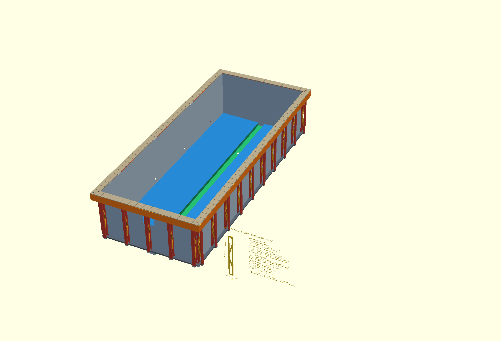
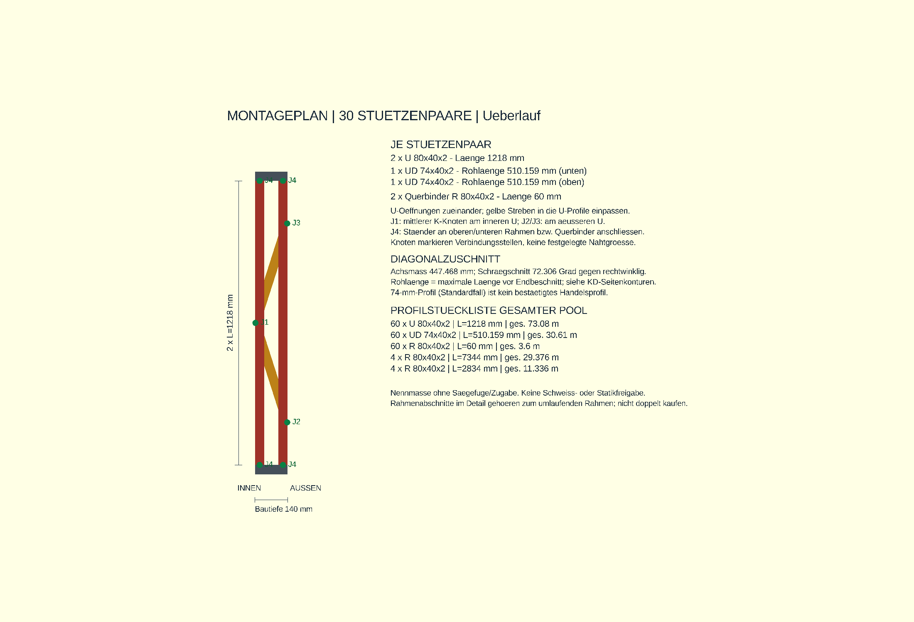

# Parametrischer Edelstahlpool · OpenSCAD

**Deutsch** | [English](README.en.md) | [Technische Dokumentation](TECHNIK.de.md)

Parametrischer Entwurf eines freistehenden Edelstahlpools mit umlaufender Überlaufrinne, geneigter Fliesenabdeckung und gegengleichen U-Stützen mit K-Verband. Abmessungen, Bauteilaufteilung und Stücklisten werden aus gemeinsamen Parametern berechnet.

**Projektstatus:** Entwicklungs- und Planungsgrundlage, noch keine freigegebene Bauanleitung, geprüfte Statik oder qualifizierte Schweißanweisung. Die Veröffentlichung als Open-Source-Projekt ist vorgesehen; eine Lizenz ist noch auszuwählen.



## Funktionen

- Veränderbare Ausschnittmaße, Höhe, Blech- und Profilabmessungen.
- Überlaufrinne mit 200 × 200 mm Fliesen als Ausgangsformat, Gefälle zum Pool, Auflagern und Anschlag.
- Zwei gegengleiche senkrechte U-Profile und zwei diagonale U-Stücke je Stützenpaar.
- Geneigter Boden zur Mittelrinne, Anschlussöffnungen und parametrierbare Einlassdüsen.
- Farbiges Modell, Montageplan und Stückliste in der OpenSCAD-Konsole.
- DXF-Konturen, Profilzuschnitte und bemaßte Einzelteilblätter.
- Optionaler Skimmer: `skimmer_aktiv=true` **ersetzt** die Überlaufrinne einschließlich Fliesen und Auflagern. Der Projektstandard ist `false`, also Überlaufbetrieb.

## Werkstoff 1.4462

Geplant ist **Duplex-Edelstahl mit der Werkstoffnummer 1.4462**, auch als **2205** bezeichnet. Er verbindet hohe Festigkeit mit guter Korrosionsbeständigkeit. „V4A“ allein ist keine eindeutige Spezifikation dieses Werkstoffs. [Outokumpu: Duplex-Werkstoffdaten](https://www.outokumpu.com/en/products/product-ranges/-/media/files/products/forta/outokumpu-forta-range-datasheet.pdf)

Der Werkstofftext im Modell ist eine Planungsvorgabe, kein Nachweis über beschafftes Material. Bei der Bestellung Werkstoffnummer, Produktform, Abmessungen, Oberfläche und Materialnachweis festlegen. Die Verfügbarkeit aller Profile in 1.4462 ist noch nicht bestätigt; insbesondere 74 mm Diagonalprofilbreite ist kein zugesichertes Handelsmaß.

Die Eignung für die tatsächliche Wasserchemie und Betriebsbedingungen bleibt zu prüfen. Die Materialwahl ersetzt keine Statik; das Modell leitet daraus keine automatische Verringerung der Blechstärke ab.

### Werkstoffauswahl nach Einsatzfall

**Projektstandort: etwa 20 m von einer Autobahn entfernt.** Art der Wasseraufbereitung, Chloridgehalt und maximale Wassertemperatur sind noch nicht festgelegt. Die folgende Tabelle ist deshalb eine Vorauswahl für einen Außenpool, keine garantierte Mindestgüte oder Freigabe. Wind, Streusalzeintrag, Feuchte, Ablagerungen und Reinigungszugänglichkeit sind zusätzlich zu berücksichtigen. Aus der Entfernung allein lässt sich keine Korrosionsklasse bestimmen.

| Einsatzfall | Werkstoffkandidat | Einordnung für dieses Projekt |
|---|---|---|
| Geringe äußere Salzbelastung, konventionell behandeltes Wasser mit geprüfter Chloridkonzentration, gut reinigbare Flächen | **1.4404 / 316L** | Vergleichs- und Basiskandidat; für den noch ungeklärten Standort direkt an der Autobahn nicht die voreingestellte Auswahl. |
| Außenpool nahe Autobahn, möglicher Bremsstaub-/Streusalzeintrag, regelmäßige Reinigung möglich | **1.4462 / Duplex 2205** | Vorläufiger Favorit für die weitere Planung dieses Projekts. Wasser- und Standortbelastung sowie das Schweißverfahren noch bestätigen. |
| Hohe Chloridbelastung, Salzelektrolyse oder starke Salzablagerungen mit wiederholtem Antrocknen | **1.4547 / 254 SMO**; alternativ **1.4410 / Superduplex 2507** prüfen | Höher legierte Kandidaten für eine gesonderte Korrosions- und Fertigungsbewertung. Nicht jede Salzelektrolyse benötigt automatisch diese Güten; entscheidend sind tatsächlicher Salz-/Chloridgehalt, Temperatur und Details. |
| 1.4539 / 904L wird als Alternative angeboten | **1.4539 / 904L** | Mögliche Alternative, aber kein pauschaler Schutzgewinn gegen Bremsstaub gegenüber 1.4462. Angebot und Schweißeignung im konkreten Einsatz vergleichen. |
| Nicht zugängliche, dauerhaft verschmutzte Spalten unter Fliesen oder an tragenden Teilen | **Keine pauschale Werkstofffreigabe** | Konstruktion, Entwässerung und Wartungszugang zuerst überarbeiten; eine höher legierte Güte ersetzt das nicht. |

**Begründung der Vorauswahl:** Bei starkem Streusalzeintrag kann die Beständigkeit von 316 nicht ausreichen; 2205 und 904L werden als mögliche höher beständige Alternativen genannt. Oberflächenzustand und Reinigung beeinflussen die Auswahl ebenfalls. [worldstainless: Deicing Salt – Recognizing the Corrosion Threat](https://worldstainless.org/wp-content/uploads/2025/03/DeicingSalt.pdf)

Die Hersteller-Vergleichswerte zur Lochkorrosionsbeständigkeit (PRE) liegen beispielhaft bei etwa 24 für 316L, 35 für 2205, 34 für 904L und 43 für 254 SMO bzw. 2507. Das erklärt, warum 904L nicht automatisch eine Verbesserung gegenüber 2205 ist und höher legierte Kandidaten separat betrachtet werden. **PRE ist weder eine Flugrost-Immunitätszahl noch eine Freigabe für Schweißnähte oder Spaltkorrosion.** [Outokumpu: Werkstoffvergleich](https://www.outokumpu.com/en/products/product-ranges/-/media/files/products/forta/outokumpu-forta-range-datasheet.pdf)

Bremsabrieb an stark befahrenen Straßen kann unter anderem Eisen und Kupfer enthalten. Der Nachweis dieser möglichen Quelle ist noch keine Messung am Poolstandort. [Bayerisches Landesamt für Umwelt: Staubinhaltsstoffe](https://www.lfu.bayern.de/analytik_stoffe/umweltueberwachung/anorg_analytik/staubinhaltsstoffe/index.htm)

Für diesen Entwurf sind deshalb entnehmbare Fliesen, zugängliche und spülbare Rinnen, glatte fachgerecht nachbehandelte Oberflächen sowie zugängliche Außenstützen vorzusehen. Ablagerungen dürfen nicht dauerhaft in feuchten Spalten liegen bleiben. Vor Materialbestellung Wasserwerte einschließlich Chlorid (nicht nur freiem Chlor), Temperatur, Salzaufbereitung und tatsächlichen Staub-/Salzeintrag mit Werkstofflieferant und Fertiger bewerten. Auch eine Korrosionsprobe am Standort kann die Bewertung unterstützen, ersetzt aber keinen Langzeitnachweis. Die Tabelle gilt nicht als Empfehlung für unzugängliche Deckenabhängungen in Hallenbädern.

## Laserschweißen

**Laserschweißen ist als Fertigungsweg vorgesehen, aber für diesen Pool noch nicht qualifiziert.** Laserstrahlschweißen von 1.4462 ist technisch möglich. Prozessführung und Abkühlung beeinflussen das Ferrit-/Austenit-Verhältnis und die Eigenschaften der Verbindung. Forschung an 2205 zeigt die Bedeutung der Strahlenergieverteilung; daraus ergeben sich keine universellen Einstellungen für dieses Projekt. [Brunel University: Laser welding of 2205 duplex stainless steel](https://bura.brunel.ac.uk/handle/2438/17749)

Vor Fertigung sind repräsentative Proben aus dem tatsächlichen Material und eine passende Verfahrensqualifikation erforderlich. Nahtvorbereitung, Passung, gegebenenfalls Zusatzwerkstoff, Schutzgas, Prozessparameter, Nachbehandlung und Prüfungen sind festzulegen. Das Repository enthält **keine freigegebenen Laserparameter oder Schweißanweisung (WPS)**. J1–J4 markieren Anschlussstellen, keine bemessenen Schweißnähte. Laserschweißen gehört in eine entsprechend eingerichtete Arbeitsumgebung.

## Flugrost: beständig, nicht immun

**1.4462 ist nicht immun gegen Flugrost oder Fremdeisen-Kontamination.** Abgelagerte Eisenpartikel können auch auf Edelstahl rosten und Korrosion begünstigen. Quellen sind beispielsweise Schleifstaub, Stahlbürsten und zuvor an unlegiertem Stahl verwendete Werkzeuge. Edelstahl getrennt bearbeiten und lagern; Fremdeisen, Schweißoxide und Anlauffarben fachgerecht behandeln. Eine saubere Oberfläche ist Teil des Korrosionsschutzes, keine dauerhafte Immunitätsgarantie. [ASSDA: Stainless steel fabrication – common traps to avoid](https://assda.asn.au/assda-accredited-fabricators/stainless-fabrication-common-traps-to-avoid)

## Schnellstart

Benötigt: **OpenSCAD** und für den Sammel-Export **Python 3.10 oder neuer**, ohne zusätzliche Python-Pakete.

1. `pool_parametrisch.scad` öffnen, Parameter ändern und speichern.
2. **F5** drücken: Modell, Montageplan und Konsolenstückliste aktualisieren sich.
3. `ansicht="Fertigungsplan"` zeigt den Plan allein.
4. `Export-starten.cmd` ausführen oder im Projektordner:

   ```powershell
   python export.py
   ```

5. `export-stueckliste-v4/stueckliste.html` und `schnittzeichnungen.html` öffnen.

Eine Größenvariante lässt sich auch so exportieren:

```powershell
python export.py --out export-variante -D ausschnitt_breite=4000 -D ausschnitt_laenge=9000 -D blech=3
```

Customizer-only-Änderungen übernimmt das Exportskript nicht automatisch. Werte im Quelltext speichern oder mit `-D` übergeben. Alle Maße sind mm. Vor einem reinen Modell-STL-Export `fertigungsplan_zeigen=false` setzen und weitere Darstellungsobjekte nach Bedarf ausschalten. STL speichert keine Farben.

## Stückliste und Montage



| Datei | Inhalt |
|---|---|
| `profilstueckliste_gruppiert.csv` | Anzahl, Querschnitt, Einzellänge, Gesamtmeter |
| `profile.csv` | Einzelprofile, Roh-/Achsmaße und Schnittwinkel |
| `materialliste.csv` | Blechzuschnitte und Werkstoffangabe |
| `stueckliste.txt` / `stueckliste.html` | Lesbare Übersicht und Montagehinweise |
| `montageplan.svg` | Stützenplan mit Anschlussmarkierungen |
| `*.dxf` / `*_bemassung.svg` | Konturen und Maßblätter |

Bei Diagonalen ist die Rohprofillänge von der endgültigen schrägen Kontur zu unterscheiden. `KD*.dxf` sind Profilseitenkonturen, keine Blechabwicklungen. Sägefugen, Besäumung und Schweißzugaben fehlen noch. Gesamtmeter sind keine Bestellanzahl handelsüblicher Stangen; die langen Rahmenstücke der Ausgangsvariante sind über 6 m lang.

## Offene Arbeiten und Beiträge

Offen bleiben insbesondere vollständige Tragwerksbemessung einschließlich Bodenunterstützung und Fußpunkten, Schweißdetails und Verfahrensqualifikation, Fliesen-/Rinnenauflagerbemessung sowie Hydraulik und Ansaugschutz. Die Düsenpfeile sind keine Strömungssimulation.

Beiträge zu Geometrie, Dokumentation und Prüfungen sind willkommen. Eingabewerte und Prüfergebnisse mitliefern. Geometrieprüfungen: `python verify.py --geometry-only`. Weitere Details stehen in [TECHNIK.de.md](TECHNIK.de.md).

**Vor der Veröffentlichung eine passende Lizenz für Software und Konstruktionsdaten festlegen.** Noch wurde keine Lizenz erteilt und kein Repository auf GitHub veröffentlicht.
