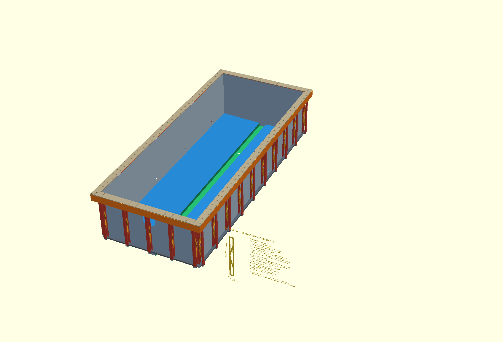
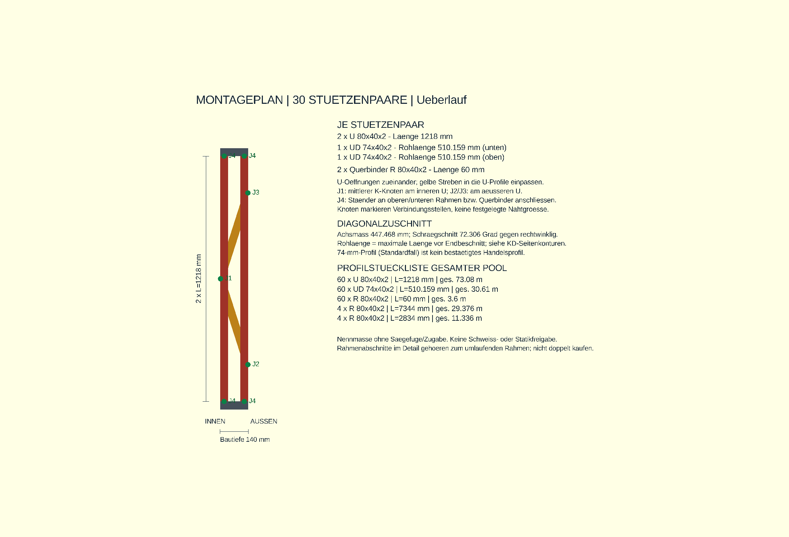

# Parametric stainless steel pool · OpenSCAD

[Deutsch](README.md) | **English** | [Detailed technical documentation (German)](TECHNIK.de.md)

A parametric design for a freestanding stainless steel pool with a perimeter overflow gutter, sloping tile cover and opposing U-channel uprights with K-bracing. Dimensions, component layouts and bills of materials are derived from shared parameters.

**Project status:** A design and development project, not an approved construction manual, verified structural design or qualified welding procedure. Open-source publication is planned; a license has not yet been selected.



## Features

- Configurable installation opening, height, sheet thickness and profile dimensions.
- Overflow gutter with nominal 200 × 200 mm tiles, slope toward the pool, bearing strips and a retaining stop.
- Two opposing vertical U-channels and two diagonal U-channel members per support assembly.
- Floor sloping toward a central channel, connection openings and configurable inlet positions.
- Colored model, assembly drawing and an OpenSCAD console bill of materials.
- DXF contours, profile cutting data and dimensioned component drawings.
- Optional skimmer: `skimmer_aktiv=true` **replaces** the overflow gutter, tiles and bearing strips. The default is `false`: an overflow pool.

## Material EN 1.4462

The intended material is **duplex stainless steel EN 1.4462**, also known as **2205**. It combines high strength with good corrosion resistance. The informal designation “V4A” does not uniquely specify this grade. [Outokumpu: Duplex material data](https://www.outokumpu.com/en/products/product-ranges/-/media/files/products/forta/outokumpu-forta-range-datasheet.pdf)

The model's material label is a design intention, not certification of purchased stock. Orders must specify the grade, product form, dimensions, finish and material documentation. Availability of every profile in 1.4462 remains unconfirmed; the 74 mm diagonal channel width is not a guaranteed stock size.

Suitability for the actual water chemistry and operating conditions remains to be assessed. Selecting this grade does not replace structural calculations, and the model does not automatically reduce sheet thickness based on material strength.

### Material selection by service conditions

**Project location: approximately 20 m from a motorway.** Water treatment, chloride concentration and maximum water temperature have not yet been specified. This table is a shortlist for an outdoor pool, not a guaranteed minimum grade or approval. Wind, deicing-salt deposition, moisture, deposits and cleaning access also matter. Distance alone does not establish a corrosion category.

| Service conditions | Candidate grade | Interpretation for this project |
|---|---|---|
| Low external salt exposure, conventionally treated water with assessed chloride concentration, readily cleaned surfaces | **1.4404 / 316L** | Baseline comparison; not the default for this motorway-adjacent site while exposure remains unknown. |
| Outdoor pool near a motorway, potential brake-dust/deicing-salt deposition, regular cleaning possible | **1.4462 / duplex 2205** | Provisional preferred candidate for further project development. Confirm water/site exposure and the welding procedure. |
| High chloride exposure, salt chlorination or heavy salt deposits with repeated drying | Assess **1.4547 / 254 SMO**, or **1.4410 / superduplex 2507** | Higher-alloy candidates requiring a separate corrosion and fabrication assessment. Salt chlorination does not automatically require these grades: actual salt/chloride concentration, temperature and detailing govern selection. |
| 1.4539 / 904L offered as an alternative | **1.4539 / 904L** | A possible alternative, not a blanket improvement over 1.4462 against brake dust. Compare the specific service conditions and fabrication proposal. |
| Inaccessible, persistently contaminated crevices beneath tiles or at structural members | **No blanket material approval** | Improve detailing, drainage and maintenance access first; a higher alloy does not replace these measures. |

**Basis for the shortlist:** Severe deicing-salt exposure can exceed the resistance of 316; 2205 and 904L are identified as possible higher-resistance alternatives. Finish and cleaning also affect selection. [worldstainless: Deicing Salt – Recognizing the Corrosion Threat](https://worldstainless.org/wp-content/uploads/2025/03/DeicingSalt.pdf)

Illustrative manufacturer PRE comparison values are approximately 24 for 316L, 35 for 2205, 34 for 904L and 43 for 254 SMO or 2507. This explains why 904L is not automatically an upgrade over 2205 and why higher-alloy options merit separate assessment. **PRE is neither a rust-staining immunity rating nor approval of a weld or crevice detail.** [Outokumpu: grade comparison](https://www.outokumpu.com/en/products/product-ranges/-/media/files/products/forta/outokumpu-forta-range-datasheet.pdf)

Brake wear near busy roads can contribute iron and copper, among other elements. Identifying a potential source is not a measurement of deposition at this pool. [Bavarian Environment Agency: particulate composition](https://www.lfu.bayern.de/analytik_stoffe/umweltueberwachung/anorg_analytik/staubinhaltsstoffe/index.htm)

This design therefore needs removable tiles, accessible and flushable gutters, smooth properly treated surfaces and access to the external supports. Deposits must not remain in persistently wet crevices. Before ordering material, assess water chloride (not just free chlorine), temperature, salt treatment and actual dust/salt exposure with the material supplier and fabricator. Site exposure coupons may inform the assessment but do not establish long-term performance. This table is not guidance for inaccessible overhead supports in indoor swimming pools.

## Laser welding

**Laser welding is the intended fabrication route, but it has not been qualified for this pool.** Laser welding of 1.4462 is technically possible. Processing and cooling affect the ferrite/austenite balance and joint properties. Research on 2205 demonstrates the importance of beam energy distribution; it does not provide universal settings for this project. [Brunel University: Laser welding of 2205 duplex stainless steel](https://bura.brunel.ac.uk/handle/2438/17749)

Representative samples of the actual material and appropriate procedure qualification are required before fabrication. Joint preparation, fit-up, filler where required, shielding gas, process parameters, post-weld treatment and inspection must be established. This repository supplies **no approved laser settings or welding procedure specification (WPS)**. J1–J4 identify connection locations, not designed weld sizes. Laser welding requires an appropriately equipped work environment.

## Rust staining: resistant, not immune

**1.4462 is not immune to rust staining from airborne or embedded iron contamination.** Deposited iron particles can rust on stainless steel and promote corrosion. Sources include grinding dust, carbon-steel brushes and tools previously used on carbon steel. Separate stainless processing and storage from contamination sources, and properly address foreign iron, weld oxides and heat tint. Surface cleanliness contributes to corrosion protection; it does not guarantee permanent immunity. [ASSDA: Stainless steel fabrication – common traps to avoid](https://assda.asn.au/assda-accredited-fabricators/stainless-fabrication-common-traps-to-avoid)

## Quick start

Requires **OpenSCAD** and, for batch export, **Python 3.10 or newer**, with no additional Python packages.

1. Open `pool_parametrisch.scad`, adjust the parameters and save.
2. Press **F5** to update the model, assembly drawing and console bill of materials.
3. Set `ansicht="Fertigungsplan"` to display the drawing on its own.
4. Run `Export-starten.cmd`, or execute this in the project directory:

   ```powershell
   python export.py
   ```

5. Open `export-stueckliste-v4/stueckliste.html` and `schnittzeichnungen.html`.

Example size variant:

```powershell
python export.py --out export-variant -D ausschnitt_breite=4000 -D ausschnitt_laenge=9000 -D blech=3
```

Customizer-only changes are not automatically passed to the export script. Save values in the source or pass them with `-D`. All dimensions are millimeters. For a model-only STL, set `fertigungsplan_zeigen=false` and disable other display objects as needed. STL does not retain colors. Parameter names and generated drawing labels currently remain in German.

## Bill of materials and assembly



| File | Contents |
|---|---|
| `profilstueckliste_gruppiert.csv` | Quantity, section, individual length, total meters |
| `profile.csv` | Individual profiles, blank/axis lengths and cutting angles |
| `materialliste.csv` | Sheet blanks and material label |
| `stueckliste.txt` / `stueckliste.html` | Readable summary and assembly notes |
| `montageplan.svg` | Support assembly drawing with joint markers |
| `*.dxf` / `*_bemassung.svg` | Contours and dimensioned drawings |

Diagonal blank lengths differ from the final angled contours. `KD*.dxf` files are profile side outlines, not sheet-metal developments. Saw kerf, end trimming and welding allowances are excluded. Total meters are not purchase quantities of standard bars; the default long frame members exceed 6 m.

## Outstanding work and contributions

Outstanding work includes complete structural design, floor support and feet, weld details and procedure qualification, tile/gutter support verification, hydraulics and suction-entrapment protection. Inlet arrows are not a flow simulation.

Contributions to geometry, documentation and checks are welcome. Include input values and verification results with changes. Run geometry checks with `python verify.py --geometry-only`. Further detail is available in [TECHNIK.de.md (German)](TECHNIK.de.md).

**Select an appropriate license for software and design data before publication.** No license has been granted and no GitHub repository has been published yet.
